# ♻️ KabadiAI (कबाड़ीAI)
> **AI-Powered E-Waste Identification, Deterministic Safety Guardrails, Indicative Fair Pricing & Listed Recycler Routing for India.**

[](https://main.d33iyw8b7i40jw.amplifyapp.com)
[](https://aws.amazon.com)
[](https://ai.google.dev)
[-000000?style=for-the-badge&logo=nextdotjs)](https://nextjs.org)
[](./LICENSE)

---

## 🔗 Live Deployments & Demos

* 🌐 **Live Web Application (AWS Amplify):** [https://main.d33iyw8b7i40jw.amplifyapp.com](https://main.d33iyw8b7i40jw.amplifyapp.com)
* ⚡ **Live Production API Gateway:** `https://jvysfh6bc0.execute-api.us-east-1.amazonaws.com`
* 🏆 **Hackathon Track:** Waste & Energy (Bharat Builds Tour: Environmental Hacks 2026)

---

## 📌 Executive Summary & The Problem

Over **90% of India's e-waste** is handled through informal scrap supply chains (*kabadiwalas*, scrap aggregators, and unauthorized backyard dismantling shops). While informal collection networks are extraordinarily agile, they face three major systemic issues:

1. **Dangerous Dismantling Hazards:** Backyard extractors burn printed circuit boards (PCBs) or use open-air acid leaching to extract gold and copper, releasing neurotoxic lead, mercury vapors, and dioxins into residential air and groundwater. Swollen lithium batteries and unevacuated AC refrigerant compressors pose immediate fire and explosion hazards.
2. **Information Asymmetry in Scrap Pricing:** Households have no objective benchmark for what discarded motherboards, copper coils, or obsolete gadgets are worth. They either hoard toxic electronics indefinitely or sell them for negligible sums to collectors who lack safety equipment.
3. **Disconnection from Formal Channels:** Citizens do not know where registered recyclers exist, resulting in valuable recyclable materials being dumped in landfills rather than fed into registered processing facilities.

**KabadiAI** bridges this gap directly from any smartphone browser. A citizen or scrap collector photographs obsolete electronics; the system instantly identifies the components, flags lethal hazardous items using **hardcoded deterministic safety guardrails**, estimates indicative scrap valuations based on Delhi scrap market benchmarks, and plots nearest authorized recyclers and drop-off points with 1-click Google Maps navigation.

---

## 🌟 Key Features

### 1. 📸 Dual-Provider Vision AI with Zero-Downtime Fallback
* Evaluates photographed e-waste in real-time.
* **Primary Engine:** Google Gemini 3.5 Flash (`gemini-3.5-flash`) for rapid, high-accuracy item classification and condition analysis.
* **Enterprise Fallback:** Amazon Bedrock (`amazon.nova-2-lite-v1:0`), automatically invoked if the primary vision API experiences rate limits, timeouts, or transient downtime.
* Client-side canvas resizing ensures fast uploads even on low-bandwidth 3G/4G connections.

### 2. 🛡️ Deterministic Safety Guardrails (Zero Hallucination Tolerance)
* **Crucial Architectural Rule:** The generative vision model is **only** permitted to identify visible components and physical conditions (e.g., `li_ion_battery`, `swollen`).
* Safety warnings are **never generated by the LLM**. They are strictly asserted via deterministic server-side rules mapped to audited environmental protocols (CPCB/SPCB guidelines):
  * ⚠️ **Swollen Lithium Battery:** Alert against crushing, puncturing, or heat exposure.
  * ⚠️ **Leaking Battery:** Contact warning, chemical hazard protocol.
  * ⚠️ **Mercury Discharge (CFLs / Fluorescent Tubes):** Explicit warning against breaking glass.
  * ⚠️ **CRT / Lead Glass:** Lead toxicity prevention protocol.
  * ⚠️ **Lead-Acid Accumulator:** Acid spill and toxic heavy metal prevention.
  * ⚠️ **Refrigerant Gas (ACs / Fridges):** Warning against cutting pressurized compressor lines.
* Full safety guidance is provided bilingually in **English and Hindi**.

### 3. 💰 Transparent Indicative Valuation Engine
* Pricing is calculated directly from an Amazon DynamoDB price table (`PricesTable`) seeded with benchmark prices from Delhi scrap market surveys and CPCB material studies.
* **Per-Piece vs. Per-Kg Differentiation:**
  * **Per-Piece Items** (e.g., whole laptops, CRT monitors, mobile phones, desktop CPUs) price strictly by item count. They do not inflate incorrectly when lot weight changes.
  * **Per-Kg Materials** (e.g., copper wire, aluminum heatsinks, motherboard scrap) calculate based on estimated metal content.
* **User Weight Calibration:** If the user specifies an exact measured scale weight (e.g. 1.5 kg), the engine proportionally recalibrates the visual weights across all scrap items while keeping per-piece items constant.
* Includes a built-in safety zero-weight fallback algorithm: if visual estimates total 0, user weight divides evenly across items rather than collapsing prices to ₹0.

### 4. 🗺️ Listed Recycler & Drop-Off Routing
* **54 Authorized Recyclers** sourced from official CPCB (Central Pollution Control Board) registered recycler registers (including annual processing capacity in MTA).
* **208 Listed Drop-Off Centers** sourced from producer collection registries and third-party e-waste programs across India.
* Real-time **Haversine distance calculation** using the user's GPS coordinates (or city lookup) to rank the closest options with direct 1-click Google Maps turn-by-turn directions.
* *Note:* Recycler coordinates represent listed facility locations, while collection points map to approximate city or area centers.

### 5. 💬 WhatsApp Shareable Appraisal Card
* Generates a clean, copyable appraisal card formatted for WhatsApp.
* Enables households to share verified item lists, hazard notes, and fair price benchmarks directly with their local *kabadiwala* prior to pickup.

### 6. 🌐 Offline-First PWA with Auto-Sync
* Offline scans are stored locally in the browser using IndexedDB (`idb-keyval`).
* When cellular or Wi-Fi connectivity returns, an automatic background queue listener uploads pending scans and alerts the user.

### 7. 🔊 Multilingual Voice Guidance (English & हिन्दी)
* Complete bilingual interface (English and Hindi).
* Integrated Web Speech API text-to-speech provides spoken audio narration for safety advisories and valuation ranges, ensuring accessibility for informal workers.

### 8. 🗺️ E-Waste Hotspot Map (`/map`)
* Interactive spatial visualization powered by Leaflet.js.
* Aggregates anonymous scan records into ~1 km grid cells (`cell_lat`, `cell_lon`) to protect citizen privacy while exposing neighborhood hazard hotspots and scrap accumulation patterns.

### 9. 🚛 Neighborhood Bulk Pickup Board (`/pickups`)
* Enables households or societies with heavy items (e.g., washing machines, CRT televisions, server racks) to post pickup requests.
* Local collectors can view active requests with coordinates and distance.
* Built-in DynamoDB TTL automatically purges stale pickup requests after 7 days.

### 10. 🤖 AI Waste Analyst (`/insights`)
* An interactive multi-turn Gemini function-calling agent for municipal planners and recycler procurement managers.
* Queries the anonymous aggregated DynamoDB lot ledger using strict tools (`overview`, `hotspots`, `material_by_area`). Every number presented is retrieved directly from database queries rather than hallucinated.

### 11. 🔐 Production Authentication System
* Email & password signup/login using standard-library PBKDF2-HMAC-SHA256 password hashing.
* Pure standard-library HMAC-SHA256 (HS256) JWT generation and verification.
* Full Google OAuth 2.0 Identity verification.

### 12. 🏆 Circular Gamification & Green Impact Engine
* **10-Tier Leveling & Bilingual Progression:** Progress from *Kabaadi Novice* (कबाड़ी नौसिखिया) 🌱 to *Prakriti Rakshak* (प्रकृति रक्षक) 👑 with animated level-up celebrations and persistent rank perks.
* **Deterministic Environmental Math:** Automatically translates scanned e-waste weights into real ecological milestones:
  * ☁️ **CO₂ Avoided:** Computed via item-specific LCA carbon emission factors (e.g., 6.0 kg CO₂/kg for motherboards, 8.0 kg CO₂/kg for aluminium heatsinks).
  * ⚡ **Clean Energy Conserved:** Tracks megawatt-hours diverted from raw ore smelting.
  * 🌳 **Equivalent Trees Planted:** Standardized EPA benchmark ($20\text{ kg CO}_2 = 1\text{ mature tree-year}$).
* **🃏 28 Collectible E-Waste Cards:** Complete deck across 4 rarity tiers (Common, Rare, Epic, Legendary). Each card provides recycling market trivia, hazardous elements, and safe extraction guidelines.
* **🎖️ 30 Circular Badges:** Milestones recognizing environmental impact, safety compliance, community pickups, and daily consistency.
* **🔥 Dynamic Streaks & Freeze Tokens:** Daily scan streak tracking with active multipliers (up to 2.5x XP). Missed days automatically consume *Streak Freeze* tokens to safeguard streaks without penalty.
* **🎰 Daily Lucky Spin Wheel:** 1 free spin every 24 hours rewarding 50 to 500 bonus XP and streak protections.
* **🥇 City & National Green Leaderboards:** Live rankings across Delhi-NCR, Mumbai, Bengaluru, and All-India with 1-click WhatsApp community challenge cards.

### 13. 📱 Adaptive Dual-Layout UX (Desktop & Mobile)
* **Desktop Mode (>= 768px):** Clean 2-column workspace featuring a sticky `DesktopPlayerSidebar` with live XP progress, streak multiplier, 1-click daily quest claims, and ecological impact gauges. Top navigation shows compact icons on intermediate widths and expands to full labels on wide screens (`>= 1280px`).
* **Mobile Mode (< 768px):** Fixed glassmorphism bottom navigation (`MobileBottomNav`) with [Scan], [Ranks], [Quests], [Cards], and [Profile]. Header automatically adapts on small screens (< 400px) by hiding redundant flame streaks and compacting action buttons to guarantee zero overflow or line-wrapping.

---

## 🏗️ System Architecture

```mermaid
flowchart TD
    subgraph Client["Frontend Client (Next.js 14 PWA on AWS Amplify)"]
        UI["Mobile Web Camera / Upload"]
        PWA["Offline IndexedDB Queue (idb-keyval)"]
        TTS["Bilingual Voice Narration (Web Speech API)"]
        LEAF["Leaflet Hotspot Map & Recycler Locator"]
        GAME_CTX["GamificationContext (XP, Streaks, Confetti)"]
        SIDEBAR["Desktop Sidebar & Mobile Glass Bottom Nav"]
    end

    subgraph AWS["AWS Cloud Infrastructure (us-east-1)"]
        APIGW["Amazon API Gateway (HTTP API)"]
        
        subgraph Lambdas["Python 3.13 Lambda Functions"]
            AGENT["Agent Lambda (/agent)\nDeterministic Pipeline + Strands Tooling"]
            GAMIFICATION["Gamification Lambda (/gamification/*)\nXP, Streaks, Cards, Leaderboard, Spin"]
            ANALYST["Analyst Lambda (/analyst)\nGemini Tool-Calling Analytics"]
            STATS["Hotspots Lambda (/hotspots)\nSpatial 1km Grid Clustering"]
            PICKUP["Pickup Lambda (/pickup)\nBulk Requests with 7-Day TTL"]
            AUTH["Auth Lambda (/auth/*)\nPBKDF2 + JWT + Google OAuth"]
            LOTS["Lots Lambda (/lots/*, /stats)\nPublic Metrics & Records"]
        end

        subgraph Storage["Amazon DynamoDB Tables"]
            DDB_P["PricesTable\n(Historical Benchmarks)"]
            DDB_R["RecyclersTable\n(CPCB + Drop-Off Directory)"]
            DDB_L["LotsTable\n(Anonymous 30-Day TTL Ledger)"]
            DDB_PK["PickupsTable\n(7-Day TTL Bulk Alert Board)"]
            DDB_U["UsersTable\n(Profiles, XP, Streaks & Cards)"]
        end
    end

    subgraph AI["Vision & Reasoning Providers"]
        GEMINI["Google Gemini 3.5 Flash\n(Primary REST API)"]
        BEDROCK["Amazon Bedrock Nova 2 Lite\n(Automatic Enterprise Fallback)"]
    end

    UI -->|Photo + GPS + Weight| APIGW
    PWA -->|Auto-Sync on Reconnect| APIGW
    GAME_CTX -->|Scan Rewards & Leaderboard| APIGW
    APIGW --> AGENT
    APIGW --> GAMIFICATION
    APIGW --> ANALYST
    APIGW --> STATS
    APIGW --> PICKUP
    APIGW --> AUTH
    APIGW --> LOTS

    AGENT -->|1. Try Gemini| GEMINI
    AGENT -.->|2. Fallback on Failure| BEDROCK
    AGENT -->|Deterministic Price Lookup| DDB_P
    AGENT -->|Geospatial Radius Query| DDB_R
    AGENT -->|Anonymous Scan Record| DDB_L

    GAMIFICATION -->|Player Profile & Rankings| DDB_U
    ANALYST -->|Database Tools| DDB_L
    ANALYST -->|Tool-Calling Loop| GEMINI
    STATS --> DDB_L
    PICKUP --> DDB_PK
    AUTH --> DDB_U
```



---

## 🔬 Deterministic Safety & Valuation Pipeline

To ensure absolute reliability in environmental hacks where bad advice can cause physical harm, KabadiAI separates visual interpretation from fact retrieval:

```
[User Photo] 
      │
      ▼
┌──────────────────────────────────────────────┐
│  Vision AI (Gemini 3.5 Flash / Bedrock Nova) │ ──> ONLY detects: items, count, visual condition
└──────────────────────────────────────────────┘
      │
      ├───────────────────────────────┬───────────────────────────────┐
      ▼                               ▼                               ▼
┌───────────────────────────┐   ┌───────────────────────────┐   ┌───────────────────────────┐
│ Hardcoded Safety Matrix   │   │ DynamoDB Prices Table     │   │ DynamoDB Recycler Table   │
│ Swollen battery? Leaking? │   │ Look up per-piece & per-kg│   │ Haversine formula distance│
│ Mercury tube? CRT glass?  │   │ market benchmark rates    │   │ to 54 CPCB + 208 points   │
└───────────────────────────┘   └───────────────────────────┘   └───────────────────────────┘
      │                               │                               │
      └───────────────────────────────┼───────────────────────────────┘
                                      ▼
                        [Validated Safe Response]
```

### Supported E-Waste Component Categories
* **Computing & Office:** `desktop_cpu`, `laptop`, `motherboard`, `ram_stick`, `hard_drive`, `power_supply`, `printer`, `router_or_modem`, `mobile_phone`, `mobile_pcb`, `charger_adapter`, `remote`
* **Displays:** `crt_monitor_or_tv`, `lcd_led_monitor_or_tv`
* **Scrap & Metals:** `copper_wire`, `copper_scrap`, `aluminium_heatsink`
* **Appliances:** `split_ac`, `window_ac`, `refrigerator`, `washing_machine`, `microwave`
* **Batteries & Hazards:** `li_ion_battery`, `lead_acid_battery`, `alkaline_battery`, `cfl_or_tube_light`, `ups_unit`

---

## 📊 Recycler & Drop-Off Dataset Transparency

In compliance with hackathon evaluation standards, we maintain strict transparency regarding our directories:

| Dataset | Count | Source | Verification & Precision Level |
| :--- | :---: | :--- | :--- |
| **Authorized E-Waste Recyclers** | 54 | CPCB (Central Pollution Control Board) Registered Recyclers List | Official regulatory list with authorized capacities (MTA). Exact registered facility addresses. |
| **Listed Collection & Drop-Off Points** | 208 | Producer Take-Back Schemes & Third-Party Drop-off Registries | Listed collection points across major Indian metros. Mapped to approximate city/area centers. |

---

## 🛠️ Tech Stack Breakdown

### Frontend
* **Framework:** Next.js 14.2 (React 18, App Router, TypeScript)
* **Styling:** Vanilla CSS design tokens + Tailwind CSS v3.4 (Dark glassmorphism aesthetic, Outfit & Inter typography)
* **Maps & Geospatial:** Leaflet 1.9 & React-Leaflet
* **Offline Persistence:** `idb-keyval` (IndexedDB lightweight wrapper)
* **Gamification & Celebrations:** `canvas-confetti` + Custom `GamificationContext`
* **Voice Synthesis:** HTML5 Web Speech API
* **Auth Client:** `@react-oauth/google` + Custom JWT storage

### Backend & Cloud Infrastructure
* **Deployment Tool:** AWS Serverless Application Model (SAM CLI)
* **Runtime:** Python 3.13 on AWS Lambda
* **API Layer:** AWS API Gateway (HTTP API v2) with CORS, route-level throttling, and IAM policies
* **Database:** Amazon DynamoDB (5 on-demand tables with TTL lifecycle policies: `PricesTable`, `RecyclersTable`, `LotsTable`, `PickupsTable`, `UsersTable`)
* **AI Orchestration:** Native Python `urllib` & AWS Boto3 SDK (zero heavy dependencies for ultra-fast cold starts)
* **Hosting:** AWS Amplify Hosting (Continuous Deployment via Git)

---

## 🧪 Testing & Accuracy Verification

The project includes an automated test suite (**16/16 unit and integration tests passing**) covering the valuation engine, weight redistribution math, environmental impact formulas, streak algorithms, and recycler geospatial queries:

```bash
# Run pytest suite
python3 -m pytest tests/ -v
```

### Test Coverage Highlights:
* `test_level_progression`: Validates XP thresholds across all 10 tiers from Novice (0 XP) to Prakriti Rakshak (80,000+ XP).
* `test_streak_calculation_consecutive`: Verifies daily streak counter increments and multiplier scaling up to 2.5x.
* `test_streak_freeze_token_usage`: Validates that missed days consume Streak Freeze tokens without resetting player streaks.
* `test_environmental_impact_math`: Verifies deterministic LCA formulas for CO₂ offset, energy saved, and tree equivalents.
* `test_leaderboard_user_placement`: Confirms real-time user placement on city/national boards based on XP and diverted kg.
* `test_badges_and_cards_integrity`: Validates integrity of all 30 badges, 28 circular collectible cards, and story quests.
* `test_lambda_handler_scan_reward`: End-to-end integration test of `/gamification/scan-reward` payload generation.
* `test_user_weight_scaling_proportional`: Validates that visual weights are scaled accurately when a user supplies an exact scale weight.
* `test_user_weight_scaling_zero_total_fallback`: Proves that when visual weights total 0, user weight divides evenly across items rather than collapsing prices to ₹0.
* `test_user_weight_validation_bounds`: Enforces input boundaries between 1g and 2,000,000g (2 tons).
* `test_per_piece_versus_per_kg_logic`: Validates that whole appliances and electronics price strictly per unit while metal scrap prices per kg.
* `test_recycler_distance_sorting`: Verifies that Haversine distance calculations correctly sort recyclers from closest to farthest.

---

## 🚀 Local Development Guide

### 1. Prerequisites
* Python 3.9+ or 3.13
* Node.js 18+ and `npm`
* AWS CLI and AWS SAM CLI configured with active credentials

### 2. Backend Setup
```bash
# Clone the repository
git clone https://github.com/Kaltroniz/KabbadiAI.git
cd KabbadiAI

# Install test and development dependencies
pip install pytest boto3

# Run tests (16 passing tests)
python3 -m pytest tests/ -v

# Build SAM application
sam build

# Deploy to AWS (guided first time)
sam deploy --guided
```

### 3. Frontend Setup
```bash
cd frontend

# Install dependencies
npm install

# Configure environment variables
cp .env.local.example .env.local
# Set NEXT_PUBLIC_API_URL to your SAM ApiUrl or live endpoint

# Start Next.js local development server
npm run dev
```
Open [http://localhost:3000](http://localhost:3000) to view the app.

---

## 📁 Repository Structure

```
KabbadiAI/
├── .aws-sam/                 # SAM build artifacts
├── data/
│   ├── prices.json           # Indicative scrap & component price benchmarks
│   ├── recyclers_cpcb.json   # 54 CPCB-registered recyclers with capacity
│   └── collection_points.json# 208 listed drop-off points with approximate coords
├── frontend/
│   ├── src/
│   │   ├── app/
│   │   │   ├── auth/         # Login, Register & Google OAuth routes
│   │   │   ├── cards/        # 🃏 28 Collectible E-Waste Cards Deck Screen
│   │   │   ├── insights/     # AI Waste Analyst dashboard (Gemini tool-calling)
│   │   │   ├── leaderboard/  # 🏆 City & National Green Leaderboards
│   │   │   ├── map/          # Leaflet E-Waste Hotspot Map
│   │   │   ├── pickups/      # Neighborhood Bulk Pickup Alert Board
│   │   │   ├── profile/      # 🎖️ Recycler Profile, Badges & Impact Gauges
│   │   │   ├── quests/       # 📜 Daily Challenges & Story Quests Screen
│   │   │   ├── page.tsx      # Main Camera Scan, Valuation & Recycler Screen
│   │   │   └── globals.css   # Curated dark-mode theme & responsive media queries
│   │   ├── components/
│   │   │   ├── AppNavbar.tsx # Responsive header (icon nav < 1280px, < 400px phone pill)
│   │   │   ├── DesktopPlayerSidebar.tsx # Sticky desktop gamification sidebar
│   │   │   ├── MobileBottomNav.tsx # Fixed glassmorphism mobile PWA navigation
│   │   │   ├── gamification/ # Badges, Cards, Podium, Modals & XP Toast components
│   │   │   ├── CameraCapture.tsx # Two-stage camera scan with preview confirmation
│   │   │   ├── ResultDisplay.tsx # Safety warnings, pricing & WhatsApp card
│   │   │   └── HotspotMap.tsx# Spatial Leaflet map with recycler filtering
│   │   ├── contexts/
│   │   │   ├── GamificationContext.tsx # XP state, streaks, confetti & unlocked cards
│   │   │   ├── LanguageContext.tsx     # Bilingual translation & Web Speech TTS
│   │   │   └── AuthContext.tsx         # JWT token management & Google login
│   │   ├── data/
│   │   │   └── gamificationData.ts     # 10 levels, 30 badges, 28 cards, quests
│   │   └── locales/          # Bilingual translation files (en.json, hi.json)
├── scripts/
│   ├── accuracy.py           # Benchmark evaluation script
│   ├── build_recyclers_cpcb.py # Scrapes and formats CPCB registered recyclers
│   ├── seed_db.py            # Seeds DynamoDB tables with price & recycler datasets
│   └── deploy_amplify.py     # AWS Amplify automation script
├── src/                      # AWS Lambda backend handlers
│   ├── agent/app.py          # Vision AI + deterministic pricing/safety engine
│   ├── analyst/app.py        # Gemini function-calling multi-turn ledger analyst
│   ├── auth/app.py           # PBKDF2 password hashing + JWT + Google OAuth
│   ├── gamification/app.py   # XP calculations, streaks, badges, spins & boards
│   ├── lots/app.py           # Anonymous lot retrieval & platform stats
│   ├── pickup/app.py         # Bulk pickup request handlers (7-day TTL)
│   └── stats/app.py          # Spatial ~1km grid clustering for hotspot map
├── tests/
│   ├── test_gamification.py  # Unit & integration tests for gamification engine
│   ├── test_price.py         # Unit tests for pricing, weights & boundaries
│   └── test_recyclers.py     # Unit tests for geospatial filtering & formatting
├── IMPLEMENTATION.md         # Comprehensive project architecture specification
├── template.yaml             # AWS SAM Infrastructure as Code (IaC)
└── README.md                 # Project presentation document
```

---

## 🏆 Hackathon Submission Notes & Compliance

* **Track:** Environmental Hacks (Waste and Energy)
* **Truth in Advertising:**
  * Coordinates for recyclers and drop-off points are transparently stated as registered addresses and approximate city centers.
  * Valuations are clearly disclaimed as indicative estimates, not official commercial appraisals.
  * Under 2022 Indian E-Waste Management Rules, formal EPR credits are only generated by registered recyclers. KabadiAI does not make unauthorized EPR generation claims.
* **Open Source License:** Distributed under the [MIT License](./LICENSE).

---

<div align="center">
  <b>Built with ❤️ for a cleaner, safer, and formal e-waste circular economy across Bharat.</b>
</div>
