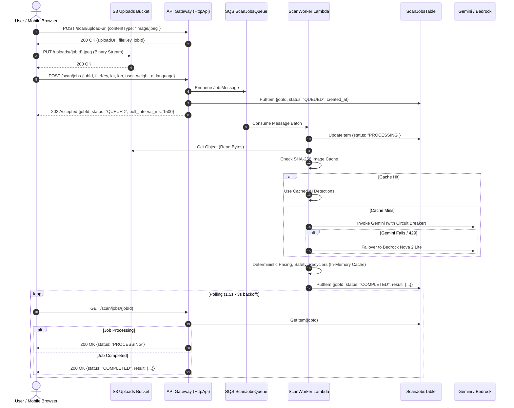
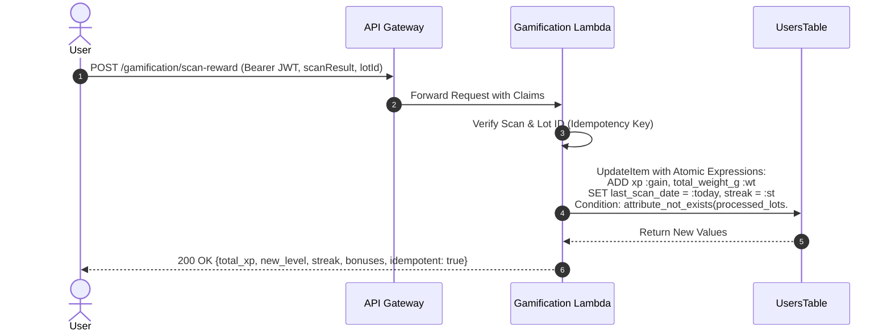

# KabadiAI High-Scalability Architecture Specification

This document details the target architecture, data flows, and component interactions designed to support 50,000 DAU at sub-second p95 latencies.

## 1. System Topology Overview

```mermaid
graph TB
    subgraph Clients["Clients & Edge Network"]
        MobilePWA["Mobile PWA (Amplify Hosting)"]
        SW["Service Worker Cache & Offline Queue"]
        CF["CloudFront Global Edge CDN (India Edge POPs)"]
    end

    subgraph API_Tier["API Gateway HTTP API v2"]
        APIGW["HttpApi Gateway (us-east-1)"]
        RouteRead["Read Route Settings (Burst: 200, Rate: 150)"]
        RouteWrite["Write Route Settings (Burst: 40, Rate: 20)"]
    end

    subgraph Async_Engine["Async AI Processing Subsystem"]
        S3Bucket[("S3 Uploads Bucket<br/>(24h Lifecycle Expiration)")]
        SQSQueue["SQS ScanJobsQueue<br/>(DLQ attached)"]
        WorkerLambda["ScanWorkerFunction<br/>(Batch Size: 5, Max Concurrency: 80)"]
        DedupCache[("ScanDedupCache<br/>SHA-256 Hash Matching")]
    end

    subgraph AI_Core["Resilient AI Engine"]
        CB["Circuit Breaker<br/>(Max Failures: 3, Cooloff: 30s)"]
        GeminiFlash["Google Gemini Flash REST"]
        BedrockNova["AWS Bedrock Nova 2 Lite"]
    end

    subgraph Storage_Tier["DynamoDB On-Demand Tables"]
        ScanJobs[("ScanJobsTable (TTL 24h)")]
        UsersTbl[("UsersTable (GSI: city-xp-index)")]
        AggregatesTbl[("AggregatesTable (Hotspots & Stats)")]
        PricesTbl[("PricesTable (In-Memory Cached)")]
        RecyclersTbl[("RecyclersTable (In-Memory Cached)")]
    end

    MobilePWA --> CF
    CF --> APIGW
    APIGW --> RouteRead
    APIGW --> RouteWrite

    RouteWrite -->|1. Get Presigned URL| MobilePWA
    MobilePWA -->|2. Direct PUT Image| S3Bucket
    MobilePWA -->|3. POST /scan/jobs| SQSQueue
    SQSQueue --> WorkerLambda
    WorkerLambda --> DedupCache
    WorkerLambda --> CB
    CB -->|Primary| GeminiFlash
    CB -.->|Fallback| BedrockNova
    WorkerLambda --> ScanJobs
    MobilePWA -->|4. Poll /scan/jobs/{id}| ScanJobs

    RouteWrite -->|Atomic Gamification Updates| UsersTbl
    WorkerLambda -->|Atomic Lot Aggregation| AggregatesTbl
    RouteRead -->|Cached Reads| AggregatesTbl
    RouteRead -->|GSI Query| UsersTbl
```

## 2. Asynchronous Scan Pipeline Sequence Flow



## 3. Server-Authoritative Gamification Flow


