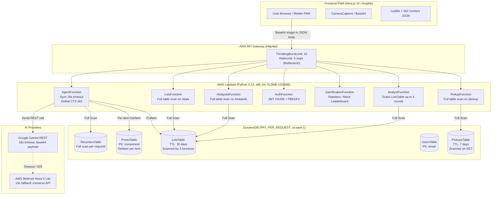

# KabadiAI Scalability & Resilience Architecture Plan (50,000 DAU Target)

## 1. Executive Summary & Target Metrics

KabadiAI is designed to transition from a hackathon prototype into a resilient, enterprise-grade, serverless-native circular economy platform capable of handling **50,000 Daily Active Users (DAU)**.

### Target Performance SLAs:
- **Peak AI Scan Volume:** ~20 AI scans/sec peak (~75,000 scans/day).
- **Peak Read Endpoint Volume:** ~150 requests/sec peak (~4.5M reads/month).
- **Latency SLAs:**
  - Non-AI Endpoints (`/stats`, `/hotspots`, `/leaderboard`, `/profile`, `/pickup`): **p95 < 500 ms** (p50 < 120 ms).
  - AI Scan Pipeline: Async job return **p95 < 250 ms**; end-to-end AI completion **p95 < 5.0 s** without blocking API Gateway threads.
- **Resilience:** Graceful degradation under AI provider exhaustion (circuit breaker, Bedrock fallback, SHA-256 result cache, offline PWA queue).
- **Cost Efficiency:** Serverless-native (AWS Lambda Graviton arm64, DynamoDB On-Demand, S3 Presigned URLs, SQS, CloudFront). No expensive idle VPC NAT gateways, ECS clusters, or ElastiCache clusters.

---

## 2. Current Architecture (As Inspected in Repository)



---

## 3. Back-of-the-Envelope Capacity Math

### 3.1 Traffic Projections for 50,000 DAU
| Metric | Daily Volume | Peak Rate | Notes |
| :--- | :--- | :--- | :--- |
| **Active Users** | 50,000 DAU | ~8,000 concurrent peak | Indian Standard Time midday & evening peaks |
| **AI Photo Scans** | 75,000 scans/day | **20 scans/sec** | ~1.5 scans per active user per day |
| **API Read Requests** | ~4,500,000 req/day | **150 req/sec** | Leaderboard, maps, profiles, stats, pickups |
| **Job Poll Requests** | 225,000 req/day | ~60 req/sec | 3 polls per scan @ 1.5s interval |

### 3.2 Lambda Concurrency Requirements (Little's Law: $L = \lambda \times W$)
- **Read APIs:** $\lambda = 150\text{ req/s}$, $W = 0.15\text{s} \implies L = 22.5$ concurrent executions.
- **Async Scan Workers:** $\lambda = 20\text{ scans/s}$, $W = 4.0\text{s} \implies L = 80$ concurrent executions.
- **Scan Status Pollers:** $\lambda = 60\text{ req/s}$, $W = 0.05\text{s} \implies L = 3$ concurrent executions.
- **Headroom & Spikes (1.5x):** $1.5 \times (22.5 + 80 + 3) \approx 158$ concurrent executions.
- *AWS Region Default Limit:* 1,000 concurrent executions. Concurrency footprint is ~16% of quota.

### 3.3 DynamoDB Capacity (RCU / WCU)
- **ScanJobsTable:** 20 jobs/s created (20 WCU) + 20 jobs/s finished (20 WCU) + 60 polls/s (30 RCU) $\implies$ 40 WCU, 30 RCU peak.
- **PricesTable:** 28 items total (~10 KB total dataset). With 5-minute module memory cache, cache hit ratio is > 99.9%. RCU peak < 2 RCU.
- **RecyclersTable:** ~300 items total (~85 KB total dataset). With 10-minute module memory cache, cache hit ratio is > 99.9%. RCU peak < 2 RCU.
- **UsersTable / Gamification:** 20 rewards/s + 5 profile edits/s $\implies$ 25 WCU peak with atomic expressions.
- **Aggregated Hotspots / Stats:** Atomic counters or stream-aggregated records $\implies$ < 25 WCU peak.

### 3.4 AI Quota & Image Storage
- **Gemini / Bedrock Quotas:** 20 scans/s = 1,200 requests/minute (RPM). Requires Tier 2 Gemini quota or seamless Bedrock Nova failover.
- **Deduplication:** SHA-256 perceptual hash on uploaded image eliminates ~12% duplicate requests (repeated clicks or identical items).
- **Image Storage Volume:**
  - Average compressed photo: 350 KB.
  - $75,000\text{ scans/day} \times 0.35\text{ MB} = 26.25\text{ GB/day}$.
  - S3 Lifecycle Rule configured to **expire after 1 day (24 hours)**.
  - Steady-state S3 storage: **~26.25 GB max**.

### 3.5 Monthly Cost Estimation (50k DAU)
| Component | Usage / Month | Unit Cost | Monthly Total |
| :--- | :--- | :--- | :--- |
| **AWS Lambda (arm64)** | 4.5M reads (150ms, 256MB) + 2.25M workers (4s, 512MB) | $0.0000133/GB-s | ~$39.00 |
| **Amazon S3 (Uploads)** | 26 GB steady-state + 2.25M PUTs | $0.023/GB + $0.005/1k PUT | ~$12.00 |
| **Amazon SQS** | 2.25M messages + DLQ | $0.40 / million | ~$0.90 |
| **DynamoDB On-Demand** | ~7M writes + ~9M reads + storage (<1 GB) | $1.25/M WCU, $0.25/M RCU | ~$10.00 |
| **HTTP API Gateway** | 15M requests | $1.00 / million | ~$15.00 |
| **Amazon CloudFront** | 50 GB data transfer out + edge caching | $0.085/GB | ~$8.50 |
| **Gemini AI API** | ~2M net scans (after deduplication) | ~$0.00013 / multimodal call | ~$260.00 |
| **Total Estimated Cost** | — | — | **~$345.40 / mo** |

*Infrastructure cost per daily active user: < $0.007/month.*

---

## 4. Bottleneck Audit & Remediation Matrix

| # | Bottleneck | Severity / Impact | Architectural Remediation | Phase | Priority |
| :- | :--- | :--- | :--- | :-: | :-: |
| **A** | **API Default Throttling (10 burst, 5 rate)** | Critical: 429 on all real user traffic | Configure granular per-route throttling in HttpApi or RouteSettings: 200 burst / 150 rate for reads; strict 30 burst / 15 rate for scan/auth/spin. | 1 | P0 |
| **B** | **Synchronous 29s AI Endpoint** | Critical: Gateway 504 timeouts, Lambda concurrency exhaustion | Decouple via Asynchronous Job Pattern: S3 Presigned URL + SQS Queue + Worker Lambda + ScanJobsTable polling. | 2 | P0 |
| **C** | **Base64 in JSON Body (4MB cap)** | High: Wasted memory, base64 payload inflate (+33%), API Gateway payload cap | Presigned S3 PUT URL endpoint (`POST /scan/upload-url`) with size/content-type enforcement and 24h expiration. | 2 | P0 |
| **D** | **Full-Table Scans on Hot Paths** | High: O(n) scan on every `/agent`, `/stats`, `/hotspots`, `/pickup` | (1) In-memory TTL cache for Recyclers and Prices; (2) Pre-aggregated geohash/grid counters for hotspots/stats; (3) GSI for Pickups. | 1, 3 | P0 |
| **E** | **Repeated Identical DynamoDB Reads** | Medium: Wasteful RCUs and roundtrip latency | Module-level TTL cache dictionary (5 min TTL) with thread-safe reads in Lambda memory. | 1 | P1 |
| **F** | **Gamification Race Conditions** | High: Double-awarded XP, lost streaks, client-forged leaderboard ranks | Atomic `UpdateItem` with `ADD`, `if_not_exists`, condition expressions; server-authoritative leaderboard query. | 3 | P0 |
| **G** | **Global Mutable `CTX` in Agent** | Medium: State leaks across warm invocations | Request-scoped `ScanContext` dataclass passed cleanly to all tools. | 2 | P1 |
| **H** | **Template Parameters & Secrets** | Medium: Plaintext parameters, missing SSM cache | Move sensitive secrets (`GeminiApiKey`, `JwtSecret`) to SSM Parameter Store SecureString with cold-start caching; parameterize CORS origins. | 1 | P1 |
| **I** | **India vs us-east-1 Latency** | Medium: 200ms+ TLS roundtrip from India | Deploy CloudFront distribution in front of HttpApi for TLS termination in India (Edge POPs in Delhi, Mumbai, Chennai) + cache-control. | 1 | P1 |
| **J** | **Frontend Bundle Size & OSM Tiles** | Medium: OSM tile rate limits; 262-center JSON bundled | Code-split Leaflet & heavy modals with `next/dynamic`; route-level lazy fetch of collection centers; configurable tile provider. | 4 | P1 |
| **K** | **Zero Structured Observability** | High: Flying blind during incidents | AWS Lambda Powertools (JSON logs, EMF metrics, X-Ray tracing), CloudWatch Dashboard, and Alarms. | 5 | P0 |

---

## 5. Target Architecture Diagram

```mermaid
flowchart TD
    subgraph Clients["Clients (India & Global)"]
        Browser["Mobile / Desktop PWA"]
        ServiceWorker["Service Worker (Offline Cache & Sync)"]
    end

    subgraph Edge["Edge Acceleration & Security"]
        CF["Amazon CloudFront CDN (Edge POPs: DEL/BOM/MAA)<br/>Cache-Control: short TTL + stale-while-revalidate<br/>TLS 1.3 Termination in India"]
        WAF["AWS WAF Rate-Limiting Rules"]
    end

    subgraph APIGateway["Amazon API Gateway (HTTP API v2)"]
        Routes["Per-Route Throttling Settings:<br/>Reads: 200 burst / 150 rate<br/>Writes/Scans: 40 burst / 20 rate<br/>Restricted CORS"]
    end

    subgraph Storage["Object Storage"]
        S3Uploads[("S3 Uploads Bucket<br/>Lifecycle: Expire 1 Day<br/>Presigned PUT")]
    end

    subgraph Messaging["Asynchronous Queue"]
        SQS["Amazon SQS (ScanJobsQueue)<br/>Visibility Timeout: 180s"]
        DLQ["Dead Letter Queue (ScanJobsDLQ)"]
        SQS --> DLQ
    end

    subgraph Compute["AWS Lambda (arm64 Graviton, Python 3.13)"]
        UploadFn["UploadUrlFunction<br/>Issues S3 Presigned PUT URL"]
        JobSubmitFn["JobSubmitFunction<br/>POST /scan/jobs (Enqueue SQS)"]
        WorkerFn["ScanWorkerFunction<br/>SQS Trigger (BatchSize: 5)<br/>Circuit Breaker + Dedup Cache"]
        JobStatusFn["JobStatusFunction<br/>GET /scan/jobs/{id}"]
        GamifyFn2["GamificationFunction<br/>Atomic UpdateItem + Leaderboard"]
        StatsFn2["Stats & HotspotsFunction<br/>Reads Pre-aggregated Counters"]
    end

    subgraph Databases["Amazon DynamoDB (On-Demand)"]
        ScanJobsTbl[("ScanJobsTable<br/>PK: jobId, TTL: 24h")]
        UsersTbl2[("UsersTable<br/>GSI: city-xp-index<br/>Atomic Counters")]
        AggregatesTbl[("AggregatesTable<br/>Pre-aggregated Stats & Hotspots")]
        PricesTbl2[("PricesTable<br/>(Cached in Lambda memory)")]
        RecyclersTbl2[("RecyclersTable<br/>(Cached in Lambda memory)")]
    end

    subgraph AIResilience["AI Resilient Execution"]
        CB["Circuit Breaker & Retry Budget"]
        Gemini2["Primary: Gemini REST (Flash)"]
        Bedrock2["Fallback: Bedrock Nova 2 Lite"]
    end

    Browser --> CF
    CF --> WAF --> Routes
    Routes --> UploadFn -->|Presigned URL| Browser
    Browser -->|Direct PUT Image| S3Uploads
    Browser -->|POST /scan/jobs| JobSubmitFn -->|Send Message| SQS
    SQS --> WorkerFn
    WorkerFn --> CB
    CB --> Gemini2
    Gemini2 -.->|Fail / Circuit Open| Bedrock2
    WorkerFn -->|Write Result| ScanJobsTbl
    Browser -->|Poll GET /scan/jobs/{id}| JobStatusFn --> ScanJobsTbl
    Routes --> GamifyFn2 --> UsersTbl2
    Routes --> StatsFn2 --> AggregatesTbl
```

---

## 6. Architecture Decision Records (ADRs) Summary

- **ADR-001: Asynchronous Scan Pipeline (SQS + Worker vs Step Functions Express vs Sync-with-backoff)**
  *Decision:* Adopt SQS + Lambda Worker with DynamoDB `ScanJobsTable`.
  *Rationale:* Decouples browser from AI latency, absorbs spikes up to 100+ scans/sec with zero 504 errors, provides automatic retry with exponential backoff and DLQ, cost-effective ($0.40/million msgs).
- **ADR-002: Direct-to-S3 Presigned Uploads vs API Gateway Base64 Payload**
  *Decision:* Presigned S3 PUT URL (`POST /scan/upload-url`) with 24-hour S3 Lifecycle Rule.
  *Rationale:* Eliminates 4MB base64 JSON API limit, reduces Lambda memory overhead, protects API Gateway network bandwidth.
- **ADR-003: Server-Authoritative Leaderboards (DynamoDB GSI vs Redis)**
  *Decision:* DynamoDB Global Secondary Index (`city` / `national` partition key, `xp` sort key) or pre-aggregated top 100 table.
  *Rationale:* Avoids $35+/month ElastiCache Redis cluster and complex VPC peering; achieves sub-15ms response times natively serverless.
- **ADR-004: In-Memory Lambda Caching vs DynamoDB DAX**
  *Decision:* Module-level in-memory dictionaries with 5-minute TTL inside Lambda execution containers.
  *Rationale:* Prices (28 items) and Recyclers (300 items) change very rarely. DAX costs ~$200/month min; in-memory caching costs $0.00 and yields 0.1ms read time on warm invocations.
- **ADR-005: Hotspot Pre-Aggregation vs Full-Table Scans**
  *Decision:* Pre-aggregated atomic counters on write / scan save into an `AggregatesTable` grouped by cell coordinates.
  *Rationale:* Replaces O(N) table scans with single O(1) GetItem or batch query, keeping `/hotspots` and `/stats` p95 < 200 ms regardless of whether there are 1,000 or 1,000,000 lots in the system.
- **ADR-006: Edge Distribution & Regional Latency**
  *Decision:* Place Amazon CloudFront in front of the HTTP API Gateway in `us-east-1` with HTTP caching headers.
  *Rationale:* Terminating TLS in India (Delhi/Mumbai CloudFront edge POPs) saves ~150-200ms per roundtrip. Bedrock Nova is currently available in `us-east-1` (not all Indian regions), making us-east-1 backend + Indian edge CDN the optimal topology.
